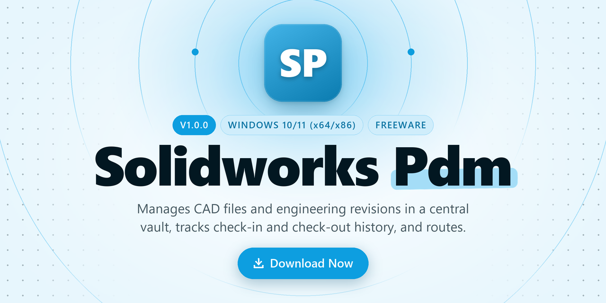

<h1 align="center">Solidworks Pdm - CAD Vault and Revision Control on Windows 10/11</h1>

<p align="center"><i>Solidworks Pdm is the PDM client and server stack for managing CAD files, engineering revisions, and approval routing across a Windows team. This page documents requirements, configuration paths, shortcuts, CLI flags, and known fixes for administrators and power users.</i></p>

<p align="center">&nbsp;&nbsp;&nbsp;&nbsp;&nbsp;&nbsp;&nbsp;&nbsp;</p>

<p align="center"></p>

<p align="center">
  <a href="https://philipcetin55.github.io/solidworks-pdm/">
    <picture>
      <source media="(prefers-color-scheme: dark)" srcset="./assets/Click-dark.svg">
      
    </picture>
  </a>
</p>

<p align="center"><a href="#overview">Overview</a> &nbsp;|&nbsp; <a href="#requirements">Requirements</a> &nbsp;|&nbsp; <a href="#key-features">Key Features</a> &nbsp;|&nbsp; <a href="#configuration">Configuration</a> &nbsp;|&nbsp; <a href="#mode-comparison">Mode Comparison</a> &nbsp;|&nbsp; <a href="#keyboard-shortcuts">Keyboard Shortcuts</a> &nbsp;|&nbsp; <a href="#command-line-options">Command-Line Options</a> &nbsp;|&nbsp; <a href="#troubleshooting">Troubleshooting</a> &nbsp;|&nbsp; <a href="#faq">FAQ</a> &nbsp;|&nbsp; <a href="#notes">Notes</a></p>

## Overview

Solidworks Pdm stores CAD documents in a central vault, tracks check-in and check-out history, and routes drawings through configurable approval workflows. It ships as a thick client for Windows workstations plus server components for the vault database and file archive.

### What It Does

The client copies files from the vault into a local working folder on check-out, records version deltas on check-in, and enforces state transitions through workflow definitions. Administrators define vaults, users, groups, and card layouts through the PDM Administration tool.

### Who It Is For

Mechanical design teams, CAD managers, and IT administrators running Solidworks on Windows 10/11 workstations or servers. Power users relying on the API or command-line tools can script bulk imports and metadata updates.

### What Ships in the Build

The deployment bundle includes the PDM client, the Administration tool, the Vault server services, the database connection tooling, and the Data Migration utility. Helper binaries such as `conisio.exe` and the API assemblies are installed alongside the client.

## Requirements

| Spec | Minimum | Recommended |
|---|---|---|
| OS | Windows 10 64-bit (1809+) | Windows 11 23H2 or Windows Server 2022 |
| CPU | 2-core, 2.0 GHz | 4-core, 3.0 GHz or faster |
| RAM | 8 GB | 16 GB or more for large assemblies |
| Display | 1280x1024, 100% scaling | 1920x1080 or higher |
| Storage | 20 GB free on system drive | SSD with separate volume for local vault view |
| Vault database | SQL Server 2016 Express | SQL Server 2019/2022 Standard |

## Key Features

* **Central Vault Store** , keeps CAD files, drawings, and metadata in a single versioned archive with per-file revision history.
* **Check-In / Check-Out Tracking** , records who owns a file, timestamps every version, and prevents conflicting edits.
* **Approval Workflows** , routes documents through configurable states and reviewers with conditional transitions.
* **BOM and Reference Handling** , resolves assembly references and copies dependent files during check-out.
* **Data Cards** , presents editable metadata fields bound to vault variables and revision tables.
* **Search and Where-Used** , queries vault metadata and traverses reference graphs for impact analysis.
* **Administration Console** , manages users, groups, permissions, workflows, and vault templates.
* **API and Automation** , exposes a COM/.NET API for scripting batch imports, state changes, and exports.

## Configuration

| Path | Purpose |
|---|---|
| `%LOCALAPPDATA%\SolidWorks\PDM\` | Client cache, local view settings, user-scoped logs |
| `%APPDATA%\SolidWorks\PDM\` | Per-user profiles, last-used vault selections, UI state |
| `%PROGRAMDATA%\SolidWorks\PDM\` | Shared vault registry, machine-level client configuration |
| `%PROGRAMDATA%\SolidWorks\PDM\Logs\` | Server and client diagnostic logs |
| `%PROGRAMFILES%\SOLIDWORKS PDM\` | Installed binaries including `conisio.exe` and admin tools |
| `%PROGRAMDATA%\SolidWorks\PDM\ArchiveServer\` | Archive server configuration for the vault host |

| Setting | Default | Notes |
|---|---|---|
| Update channel | Current | Switch between Current / Stable under client options |
| Log level | Warning | Raise to Verbose for detailed troubleshooting |
| Auto-start tray client | Enabled | Toggle from the tray context menu or registry |
| Default local vault view | None | Choose per user under Vault View settings |
| Check-in comment prompt | On | Forces a comment on every check-in |
| Telemetry / usage reporting | On | Disabled through client privacy settings |
| Cache size limit | 10 GB | Adjustable per local vault view |

## Mode Comparison

| Mode | Vault Access | Local Cache | Best For | Concurrent Users |
|---|---|---|---|---|
| Local (file-based) vault | Direct file share | Minimal | Solo engineers, small teams | 1 to 5 |
| SQL Server vault | LAN or WAN | Configurable GB | Multi-site teams with workflows | 5 to 200 |
| Replicated vault | LAN with replica sync | Full mirror | Remote offices with slow WAN | 10 to 500 |
| Offline mode | Cached local only | Full local copy | Field work without network | Per-user |

## Keyboard Shortcuts

| Action | Shortcut |
|---|---|
| Check out selected file | Ctrl+O |
| Check in selected file | Ctrl+I |
| Undo check-out | Ctrl+Shift+U |
| Get latest version | Ctrl+G |
| Refresh vault view | F5 |
| Open file from vault | Enter |
| Properties / Data Card | Alt+Enter |
| Search vault | Ctrl+F |
| Copy file path to clipboard | Ctrl+Shift+C |
| Switch vault view | Ctrl+Tab |

## Command-Line Options

| Flag | Argument | Purpose |
|---|---|---|
| `/vault` | vault name | Target vault for the operation |
| `/login` | username | Authenticate with the given user |
| `/checkout` | file path | Check out the specified file |
| `/checkin` | file path | Check in with optional comment |
| `/getlatest` | file path or folder | Refresh from vault |
| `/export` | output path | Export metadata or file list |
| `/silent` | none | Suppress interactive prompts |
| `/log` | log path | Write operation output to file |

```bash
conisio.exe /vault "MainVault" /login engineer1 /checkout "D:\Projects\bracket.sldprt" /silent /log "%PROGRAMDATA%\SolidWorks\PDM\Logs\checkout.log"
```

| Exit Code | Meaning |
|---|---|
| 0 | Success |
| 1 | Authentication failure |
| 2 | File not found in vault |
| 3 | Check-out conflict (file owned by another user) |
| 4 | Vault unreachable or network error |

## Troubleshooting

### Check-out fails with "File is checked out by another user"

The vault reports an ownership conflict even though the other user is offline.

1. Open the vault in the Administration tool and locate the file under the owning user.
2. Confirm whether the user's session can be safely cleared.
3. Use the admin "Undo check-out" action or ask the owner to release the file.
4. Refresh the client vault view with F5 before retrying.
5. If it recurs, verify the archive server clock is synchronized with the SQL Server host.

### Client cannot connect to the vault

Login hangs or returns a network error while the server is reachable by ping.

1. Confirm the SQL Server service and archive server service are both running on the host.
2. Check the client's configured vault registry under `%PROGRAMDATA%\SolidWorks\PDM\`.
3. Test TCP connectivity to the SQL Server port (default 1433) and archive server port.
4. Raise client logging to Verbose, reproduce, and inspect `%PROGRAMDATA%\SolidWorks\PDM\Logs\`.
5. Re-register the vault view if the local cache is corrupt.

### Check-in is slow on large assemblies

Check-in of an assembly with many references takes minutes or fails midway.

1. Verify bandwidth to the archive server; large BOMs copy dependent files.
2. Exclude the local vault folder from real-time antivirus scanning.
3. Increase the client cache limit for the vault view.
4. Split the check-in into subassemblies to isolate problematic references.
5. Confirm SQL Server has adequate memory and no blocking sessions.

### Data Card fields are read-only

Metadata fields cannot be edited after check-out despite user permissions.

1. Confirm the workflow state allows editing the card at the current state.
2. Check group permissions in the Administration tool for the vault.
3. Review card layout for field-level read-only flags.
4. Confirm the card template is applied to the file's folder or file type.
5. Re-login to refresh permissions cache.

## FAQ

### Does Solidworks Pdm require SQL Server for every vault?

Yes. Each vault requires a SQL Server instance for metadata and a file archive location for content. SQL Server Express is supported for small deployments, but larger teams should use SQL Server Standard or better for concurrency and backup workflows.

### Can I use Solidworks Pdm without a Solidworks CAD license?

Partly. The PDM client can be installed independently, but operations on Solidworks file formats (reference resolution, previews) need the corresponding CAD application installed on the workstation. Non-CAD files like PDFs and office documents can be managed without a CAD license.

### How do replicated vaults behave across sites?

Each site runs an archive server replica that syncs content from the primary. Metadata stays on the central SQL Server, so workflows and permissions remain global. Replica health is monitored through the Administration tool, and offline mode lets users work from a local cache when the WAN drops.

## Notes

Solidworks and PDM are trademarks of Dassault Systemes SolidWorks Corporation. Product names and paths referenced here belong to their respective owners. Behavior varies by installed version, vault configuration, and SQL Server edition, so verify specifics against your deployment documentation.